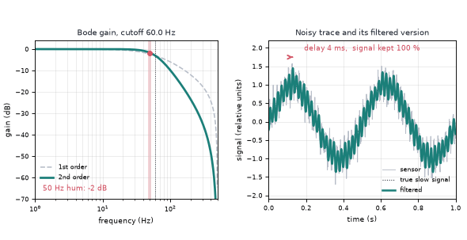
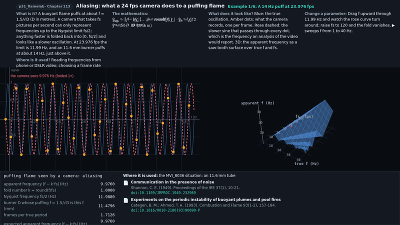
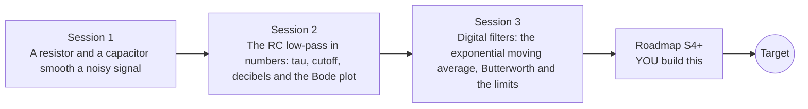

# openrcfilter

[](https://github.com/KrunalPanchal1995/openrcfilter/actions/workflows/ci.yml)   [](https://colab.research.google.com/github/KrunalPanchal1995/openrcfilter/blob/main/sessions/session-01/lesson.ipynb) [](https://krunalpanchal1995.github.io/openrcfilter/)

**Design a filter that removes noise from a sensor signal, in three sessions.**

openrcfilter teaches how a resistor, a capacitor and one line of code clean a noisy sensor signal, from the RC low-pass to the Bode plot to a digital filter you check numerically.

- **Start from zero.** Session 1 needs only a feel for fast and slow wiggles; every symbol is explained before it is used.
- **See it move.** Every session ships a slider app that runs in the browser, with labelled signal and Bode graphs.
- **Know you got it right.** Each session ends with a checkpoint that prints PASS or FAIL against hand calculations and numerical tests.
- **Build the missing half.** The repo stops at Session 3 on purpose; the roadmap shows the path to the Target.

[Target](#the-target) · [Who is this for](#who-is-this-for) · [Quick start](#quick-start) · [Sessions](#sessions) · [Roadmap](#roadmap) · [Contribute](#contribute) · [Explainer PDF](docs/explainer.pdf)

> **This repo is incomplete on purpose.** Sessions 1 to 3 are here and fully working. The finished Target below is a preview of what the community can build next. We show you the path, not the code. Sessions 4 and up are yours.

## The Target

An animated Bode plot sweeps a filter's cutoff from 60 Hz down to 1.5 Hz and back. On one side the gain curve (a second-order filter against a first-order one) slides along the frequency axis with the 50 Hz hum marked on it; on the other side a noisy sensor trace (a slow wave plus hum) is turned into a clean wave by that very filter, and the delay it costs is marked with an arrow and a number in milliseconds. Your goal over the coming sessions: build that cutoff-versus-delay picture yourself, from a notch filter to zero-phase filtering.



*Target: a Bode plot sweeping a cutoff while the filtered sensor signal shows its delay*

- [Aliasing: a frequency sweep folding back below Nyquist (video)](promo/media/alias_sweep.mp4)



*Math Visual Studio: the aliasing example*

Try it live:

- [Math Visual Studio: Laplace transforms and transfer functions (Atlas S17)](https://krunalpanchal1995.github.io/studio/#atlas?ch=S17&ex=1)
- [Math Visual Studio: Fourier analysis (Atlas S19)](https://krunalpanchal1995.github.io/studio/#atlas?ch=S19&ex=1)

How the Target was made is shown only as a path in [promo/roadmap.md](promo/roadmap.md).

## Who is this for
**secondary school to diploma / undergraduate (levels 3-5).** Topic area: Electricity, Magnetism and Electronics.

Prerequisites:

- Sine waves and the idea of frequency (cycles per second), and logarithms (powers of 10).
- Python 3.10 or newer; if `python --version` works, you are ready. PRIMER.md explains the rest.
- No prior electronics, GitHub or signal-processing experience is needed; resistors and capacitors are explained in Session 1.

New to Python? Read [PRIMER.md](PRIMER.md) first (10 minutes).

## Quick start

No installation knowledge needed. You need [Git](https://git-scm.com/downloads) and [Python 3.10+](https://www.python.org/downloads/) (Windows: tick "Add Python to PATH"). On Mac and Linux type `python3` wherever this page says `python`.

```bash
git clone https://github.com/KrunalPanchal1995/openrcfilter.git
cd openrcfilter
python start.py 1
```

`start.py` creates a private environment, installs what is needed and runs Session 1 with its checkpoint. Next: `python start.py 2`, `python start.py 3`, or `python start.py test` to check everything. Only a checkpoint: `python start.py check 1`.

Four lines turn the idea of Session 1 into a result (they work as they are): Save it as `try.py` and run it with `python start.py run try.py` (this uses the private environment, where NumPy is installed):

```python
import numpy as np
fc = 1 / (2 * np.pi * 10e3 * 3.2e-6)               # RC low-pass: 10 kohm and 3.2 uF
gain = lambda f: 1 / np.sqrt(1 + (f / fc) ** 2)    # how much of a wave of frequency f gets through
print(round(fc, 2), round(gain(2), 3), round(gain(40), 3))   # -> 4.97 0.928 0.123
```

Every session also opens in your browser with sliders (no install): [live apps](https://krunalpanchal1995.github.io/openrcfilter/). Or use the Colab badge above for the notebook.

## Sessions

| # | Session | Model level | Time | Live app |
|---|---|---|---|---|
| 1 | [A resistor and a capacitor smooth a noisy signal](sessions/session-01/README.md) | Level 1: conceptual interactive model | 60 min | [open](https://krunalpanchal1995.github.io/openrcfilter/session-01/) |
| 2 | [The RC low-pass in numbers: tau, cutoff, decibels and the Bode plot](sessions/session-02/README.md) | Level 2: mathematical engineering model | 75 min | [open](https://krunalpanchal1995.github.io/openrcfilter/session-02/) |
| 3 | [Digital filters: the exponential moving average, Butterworth and the limits](sessions/session-03/README.md) | Level 3: simulation and validation | 90 min | [open](https://krunalpanchal1995.github.io/openrcfilter/session-03/) |

Each session follows the same six steps: A real-world problem, B concept and theory, C visual explanation, D interactive simulation, E worked example and experiment, F assessment and design challenge. Each ends with `checkpoint.py`, which prints `PASS` or `FAIL` against reference numbers. Session 3 also contains the real-world mini-project: **Design the filter for a temperature sensor with 50 Hz pickup**.

## Architecture



| Folder or file | What is inside |
|---|---|
| `sessions/` | three sessions: README (A-F), `lesson.py`, notebook, live app, exercises, activity sheet, checkpoint |
| `promo/` | the Target: media, live links, and the roadmap (path only) |
| `docs/` | `explainer.tex` and the built `explainer.pdf` |
| `tests/` | runs every lesson and checkpoint headless |
| `start.py` | one command to set up and run anything |
| `QUALITY.md`, `RUBRIC.md` | the quality checklist and the scoring rubric |
| `.github/` | CI, PDF build, Pages deploy, issue and PR templates |

## Roadmap

| Milestone | What you will build | Difficulty |
|---|---|---|
| Session 4: A notch that nulls 50 Hz | A filter for the temperature sensor with a null at 50 Hz that is still fast. | intermediate |
| Session 5: Zero-phase filtering for recordings | An offline filter that smooths a recorded trace without shifting it. | intermediate |
| Session 6: Anti-alias filter and decimation | A pipeline that samples at 2000 Hz, filters, and keeps every tenth sample. | intermediate |
| Session 7: Measure a real Bode plot | A measurement script and a breadboard filter that produce a measured Bode plot. | advanced |
| Session 8: Reproduce the Target animation | A looping animation of a cutoff sweep with the gain curve on one side and the noisy and filtered signals on the other. | advanced |

Full detail with a checkpoint per milestone: [promo/roadmap.md](promo/roadmap.md).

## Contribute
New to GitHub? Read [CONTRIBUTING.md](CONTRIBUTING.md); it starts from zero. Pick an issue labelled `good first issue`. Translations into Hindi, Telugu, Tamil and Malayalam are welcome.

<details>
<summary>Development</summary>

```bash
python start.py test        # runs every lesson and checkpoint
```
Lessons use `# %%` cell markers so they open as notebooks in VS Code. See [QUALITY.md](QUALITY.md) for the standard every session meets.
</details>

## License
MIT. See [LICENSE](LICENSE). Media in `promo/media` is (c) Krunal Panchal, CC BY 4.0.

## Acknowledgments
Part of the [PAN IIT OSS](https://hellofoss.tech-iitb.org/projects) open-source teaching collection, modelled on the structure of [openspline](https://github.com/openspline/openspline). Built on ideas from the Math Visual Studio at https://krunalpanchal1995.github.io/studio/.
