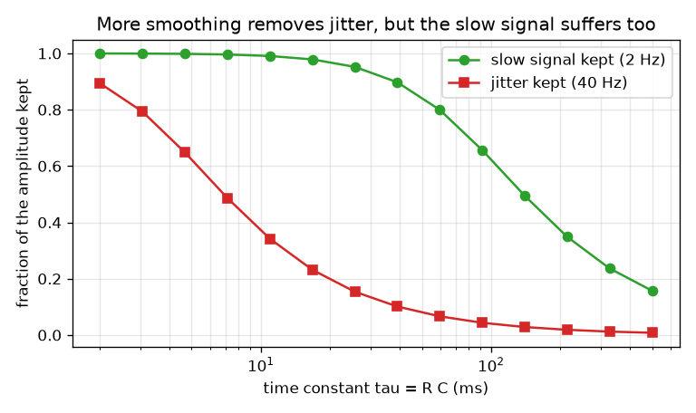
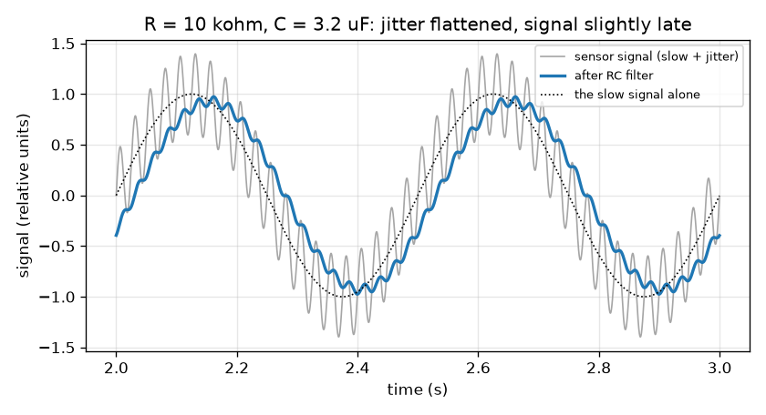

# Session 1: A resistor and a capacitor smooth a noisy signal

*Level 1 (conceptual interactive model) · about 60 minutes · openrcfilter*

> This is a simplified educational model. It is not a validated design tool and must not be used for real structures, electrical installations, vehicles, industrial processes or medical decisions.

**Prerequisites**

- Sine waves and frequency (cycles per second): fast wiggles have a high frequency.
- You have read PRIMER.md and run `python start.py 1` once.

**Learning objectives.** After this session you can:

- Describe a sensor signal as a slow part you want plus a fast part you do not.
- Explain how a resistor and a capacitor form a low-pass filter, and what the time constant tau = R C means.
- Measure how much of the slow signal and of the jitter survive a filter, and how late the output arrives.
- Read a graph of fraction kept against time constant and see the trade-off.

## A. Real-world problem
A temperature sensor is wired to a controller across a noisy room. The reading you care about changes slowly, a couple of times per second at most, but the wire also picks up fast jitter from motors and mains cables. How can two cheap parts, a resistor and a capacitor, flatten the jitter and leave the slow signal alone? And is the result free, or does it cost us something? (General education only: this is a simplified model, not a design tool for real instruments.)

## B. Concept and theory
A capacitor stores charge, like a small bucket that fills and empties. A resistor in series limits how fast current can flow into the bucket. When the input voltage changes, the capacitor voltage follows it but only gradually: it moves a fixed fraction of the remaining gap towards the input in each tiny time step. The time scale of that following is the time constant tau = R C (ohms times farads gives seconds). A slow input changes little during one tau, so the output follows it. A fast wiggle reverses before the capacitor has moved far, so it is mostly ignored. That is a low-pass filter: slow gets through, fast does not. The frequency where the filter starts to ignore waves is the cutoff f_c = 1 / (2 pi R C). The fraction of a wave of frequency f that gets through is, as a preview of Session 2, 1 / sqrt(1 + (f / f_c)^2). The price is delay: because the capacitor lags the input, the smoothed slow wave arrives late, by roughly tau for waves much slower than f_c.

| Symbol | Meaning | Unit |
|---|---|---|
| R | resistance of the series resistor | ohm (kohm = 1000 ohm) |
| C | capacitance of the capacitor | farad (uF = 0.000001 F) |
| tau | time constant R C | seconds |
| f_c | cutoff frequency | hertz (Hz) |
| f | frequency of a wave in the signal | hertz (Hz) |
| gain | output size divided by input size for one wave | no unit |

**Assumptions**

- The signal is a 2 Hz slow wave of amplitude 1 plus a 40 Hz jitter wave of amplitude 0.4 (relative units).
- Nothing is connected to the filter output (no load), and the parts are ideal.
- We look at the steady state, after the start-up wobble has died away.

$$ \tau = R\,C $$

$$ f_c = \frac{1}{2\pi R C} $$

$$ \text{gain}(f)=\frac{1}{\sqrt{1+(f/f_c)^2}}\qquad\text{(preview; derived in Session 2)} $$

$$ \text{delay of a slow wave}\approx \tau\quad (f\ll f_c) $$

## C. Visual explanation
The first figure shows the raw signal in grey (a slow wave with fast jitter on top) and the filtered output in blue for R = 10 kohm and C = 3.2 uF: the jitter is almost gone, the slow wave keeps 93 percent of its size, and it is shifted to the right by about 30 ms. The second figure sweeps the time constant: the red curve (jitter kept) falls long before the green curve (slow signal kept), but both fall, so there is a sweet spot rather than a perfect setting.

*Fraction of the slow signal and of the jitter that survives, against the time constant.*

*A slow 2 Hz signal with 40 Hz jitter before (grey) and after (blue) an RC filter with R = 10 kohm, C = 3.2 uF.*

## D. Interactive simulation
Run the lesson (`python start.py 1`), then open the live app: [Session 1: a resistor and a capacitor smooth a signal](https://krunalpanchal1995.github.io/openrcfilter/session-01/) (or `app.html` in this folder). Move the R and C sliders in the signal view and watch the jitter flatten and the blue curve lag behind the green one; then open the circuit view and watch the two bars.

**Challenge.** Keep at least 85 percent of the slow 2 Hz signal while letting through less than 20 percent of the 40 Hz jitter.

## E. Worked example and experiment
**Problem.** A filter has R = 10 kohm and C = 3.2 uF. Find tau and f_c, how much of the 2 Hz signal and of the 40 Hz jitter get through, and how late the slow wave is.

1. tau = R C = 10 000 ohm * 0.0000032 F = 0.032 s = 32 ms.
2. f_c = 1 / (2 pi * 0.032) = 4.97 Hz.
3. Slow wave (2 Hz): f / f_c = 0.402, gain = 1 / sqrt(1 + 0.162) = 0.928, so 92.8 percent is kept.
4. Jitter (40 Hz): f / f_c = 8.04, gain = 1 / sqrt(1 + 64.7) = 0.123, so 12.3 percent is kept.
5. Delay of the slow wave = atan(2 / 4.97) / (2 pi * 2) = 0.3826 rad / 12.57 = 0.0304 s, about 30 ms (a little less than tau = 32 ms, as expected).
6. The simulation in lesson.py measures 0.928, 0.123 and 30.3 ms: the numbers agree.

**Answer.** tau = 32 ms, f_c = 4.97 Hz; the slow wave keeps 92.8 percent, the jitter keeps 12.3 percent, and the slow wave is about 30 ms late.

**Experiment.** Build the filter on a breadboard (10 kohm resistor, 3.3 uF capacitor), drive it from a signal generator or a phone tone app through a sound-card input, and compare the sizes of a 2 Hz and a 40 Hz wave before and after. Expect agreement to about 10 percent: real resistors and capacitors have tolerances of 5 to 20 percent, the signal source has its own output resistance, and the measuring input loads the filter. The model assumes ideal parts and no load.

## F. Assessment and design challenge
**Question type A: Conceptual.** Why does an RC filter flatten fast jitter more than a slow wave? And why can it never remove the jitter without making the slow signal arrive late?

Hint

Think of the capacitor as a bucket that fills through a narrow pipe, and ask what happens when the input reverses before the bucket has filled.

Step-by-step solution

The capacitor only moves a fraction of the way towards the input in each time step. A slow wave stays on one side long enough for the output to follow it; a fast wave reverses before the output has moved far, so the output barely wiggles. The same sluggishness that ignores a fast wiggle also makes the output follow a slow change late, by about tau. A filter that ignores faster wiggles must therefore be slower to follow, so smoothing and delay always come together.

**Question type B: Numerical.** R = 20 kohm and C = 1 uF. Find tau, f_c, the fraction of the 2 Hz signal and of the 40 Hz jitter that is kept, and the delay of the slow wave.

Hint

tau = R C; f_c = 1 / (2 pi tau); gain = 1 / sqrt(1 + (f / f_c)^2); delay = atan(f / f_c) / (2 pi f).

Step-by-step solution

tau = 20 000 * 0.000001 = 0.020 s = 20 ms. f_c = 1 / (2 pi * 0.020) = 7.96 Hz. Slow: f / f_c = 0.251, gain = 1 / sqrt(1.0631) = 0.970 (97.0 percent). Jitter: f / f_c = 5.03, gain = 1 / sqrt(26.3) = 0.195 (19.5 percent). Delay = atan(0.251) / (2 pi * 2) = 0.2462 / 12.566 = 0.0196 s, about 19.6 ms. Sanity check: 20 ms is close to tau, as expected for a slow wave.

**Question type C: Graph and simulation interpretation.** Look at the figure of fraction kept against time constant. Could any single time constant keep at least 90 percent of the slow signal and at the same time let through less than 10 percent of the jitter?

Hint

Find the f_c needed for each wish using the gain formula, then see whether the two ranges overlap.

Step-by-step solution

Keeping at least 90 percent of the 2 Hz wave needs 1 / sqrt(1 + (2 / f_c)^2) >= 0.9, so f_c >= 4.13 Hz. Passing less than 10 percent of the 40 Hz jitter needs f_c <= 4.02 Hz. The two ranges just miss each other (4.13 is above 4.02), so no time constant meets both wishes. The two curves in the figure indeed cross the 90 percent and 10 percent lines at slightly different places. A single RC section is not steep enough when the wanted and unwanted frequencies are only a factor 20 apart; Sessions 2 and 3 show what to do.

**Question type D: Design and optimisation challenge.** Design: with C = 1 uF, choose a stock resistor so that at least 90 percent of the slow signal is kept and less than 20 percent of the jitter gets through. How late is the output?

Hint

Find the allowed range of f_c from the two wishes, convert it to a range of R with R = 1 / (2 pi f_c C), and pick a common value.

Step-by-step solution

Slow signal >= 90 percent needs f_c >= 4.13 Hz; jitter < 20 percent needs 40 / f_c > 4.90, so f_c < 8.16 Hz. With C = 1 uF, R = 1 / (2 pi f_c C) runs from 19.5 kohm (at 8.16 Hz) to 38.5 kohm (at 4.13 Hz). A stock value inside that range is 27 kohm: tau = 27 ms, f_c = 5.89 Hz, slow kept 94.7 percent, jitter kept 14.6 percent, delay 26 ms. Trade-off: a larger R removes more jitter but loses more of the slow signal and arrives later.

Score yourself with [RUBRIC.md](../../RUBRIC.md). Print the [activity sheet](activity_sheet.md) to work on paper.

## Common misconceptions
| Common misconception | What is actually true |
|---|---|
| A filter removes the jitter completely. | It only turns the jitter down. The faster the wiggle, the more it is reduced, but some always remains. |
| The filter reads the signal and decides what is noise. | It has no idea what is noise. It treats all waves the same way: it reduces each according to its frequency. |
| A bigger capacitor or resistor is always better. | Larger R or C means a larger tau: more smoothing but also more delay and more loss of the slow signal. |
| Smoothing is free. | Every low-pass filter delays the signal. Smoothing and delay come together. |

## Glossary
- **resistor**: a part that limits current; its resistance R is measured in ohms
- **capacitor**: a part that stores charge; its capacitance C is measured in farads
- **time constant**: tau = R C, the time scale on which the filter follows its input
- **low-pass filter**: a filter that lets slow changes through and reduces fast ones
- **cutoff frequency**: the frequency f_c where the filter begins to cut waves down
- **jitter**: fast unwanted wiggles on a signal

## Finish
1. Do the three coding tasks in [exercises.md](exercises.md).
2. Run `python start.py 1` again after your changes. It ends with the checkpoint; when it prints `PASS`, you are done. (Checkpoint only: `python start.py check 1`.)

Next: [Session 2](../session-02/README.md)
