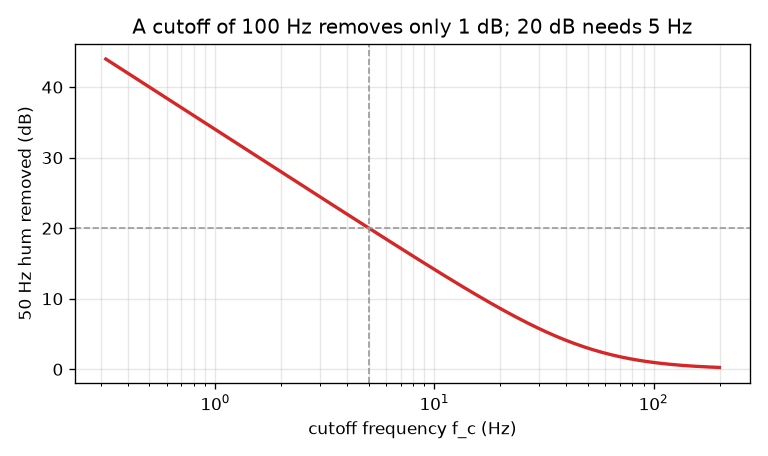
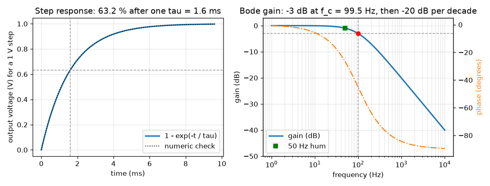

# Session 2: The RC low-pass in numbers: tau, cutoff, decibels and the Bode plot

*Level 2 (mathematical engineering model) · about 75 minutes · openrcfilter*

> This is a simplified educational model. It is not a validated design tool and must not be used for real structures, electrical installations, vehicles, industrial processes or medical decisions.

**Prerequisites**

- Session 1: the RC low-pass smooths and delays.
- Exponentials, logarithms (powers of 10) and the arctangent on a calculator.

**Learning objectives.** After this session you can:

- Use the step response 1 - exp(-t / tau) and read tau from a graph.
- Compute the cutoff frequency, the gain and the phase of an RC low-pass at any frequency.
- Convert gain to decibels and read a Bode plot: -3 dB at f_c and -20 dB per decade above it.
- Solve a design problem (choose R and C, then compute how many dB of 50 Hz hum are removed) and predict the loading effect.

## A. Real-world problem
Mains wiring leaks a 50 Hz hum into a sensor wire. An engineer picks R and C for a 100 Hz low-pass to 'remove the hum'. How many decibels of the hum does that really remove? What cutoff is needed to remove 20 dB? And what happens when the next circuit in the chain loads the filter? (A simplified model of ideal parts, for learning; not a design tool for real equipment.)

## B. Concept and theory
Apply a sudden 1 V step to the input. The current through R charges C, and the capacitor voltage obeys dv/dt = (1 - v) / tau, whose solution is v(t) = 1 - exp(-t / tau): 63.2 percent after one tau, 95.0 percent after three. For a sine of frequency f the output is a sine of the same frequency whose size and timing change. In complex form H = 1 / (1 + j 2 pi f R C). Its magnitude is the gain 1 / sqrt(1 + (f / f_c)^2) and its angle is the phase -atan(f / f_c), with f_c = 1 / (2 pi R C). At f = f_c the gain is 1 / sqrt(2) = 0.7071, which is -3.01 dB (half the power), and the phase is -45 degrees. Decibels are 20 log10(gain). Far above f_c the gain is about f_c / f, so every tenfold increase in frequency divides the gain by 10: -20 dB per decade. A Bode plot draws gain in dB (and phase) against frequency on a logarithmic axis. A load resistance R_L across the output sits in parallel with the capacitor: the DC gain becomes R_L / (R + R_L) and the cutoff uses the parallel combination of R and R_L.

| Symbol | Meaning | Unit |
|---|---|---|
| tau | time constant R C | seconds |
| v(t) | capacitor voltage for a 1 V step | volts |
| f_c | cutoff frequency, 1 / (2 pi R C) | hertz |
| \|H\| | gain: output amplitude over input amplitude | no unit |
| phase | output angle relative to the input | degrees |
| gain_dB | 20 log10 of the gain | dB |
| R_L | load resistance connected to the output | ohm |

**Assumptions**

- Ideal resistor and capacitor, a source with no resistance of its own.
- Linear behaviour: a sine in gives a sine of the same frequency out.
- The load is a plain resistor R_L; in the design problem it is infinite unless stated.

$$ v(t)=1-e^{-t/\tau},\qquad \tau=RC $$

$$ H(j\omega)=\frac{1}{1+j\omega RC},\qquad f_c=\frac{1}{2\pi RC} $$

$$ |H|=\frac{1}{\sqrt{1+(f/f_c)^2}},\qquad \varphi=-\arctan\!\left(\frac{f}{f_c}\right) $$

$$ \text{gain}_{\mathrm{dB}}=20\log_{10}|H|\quad\Rightarrow\quad |H(f_c)|=\tfrac{1}{\sqrt2}\;(-3.01\ \mathrm{dB}),\ \ -20\ \mathrm{dB/decade\ for}\ f\gg f_c $$

$$ \text{loaded: }\ G_0=\frac{R_L}{R+R_L},\qquad f_c'=\frac{1}{2\pi\,(R\parallel R_L)\,C} $$

## C. Visual explanation
The left figure plots the step response for R = 16 kohm and C = 100 nF (tau = 1.6 ms): the numerical solution of the differential equation (dotted) lies on 1 - exp(-t / tau), and the curve passes 63.2 percent at t = tau. The right figure is the Bode plot of the same filter: the gain is flat at 0 dB, passes -3 dB at f_c = 99.5 Hz (red dot), then falls on a straight line of -20 dB per decade; the orange phase curve goes from 0 to -90 degrees, passing -45 degrees at f_c. The green square at 50 Hz shows that the hum is only 1 dB down. The second figure plots hum removed against cutoff and shows that 20 dB needs a cutoff near 5 Hz.

*50 Hz hum removed (dB) against cutoff frequency: 20 dB needs about 5 Hz.*

*Left: step response, numeric and exact. Right: Bode gain (-3 dB at f_c) and phase for R = 16 kohm, C = 100 nF.*

## D. Interactive simulation
Run the lesson (`python start.py 2`), then open the live app: [Session 2: the RC low-pass in numbers](https://krunalpanchal1995.github.io/openrcfilter/session-02/) (or `app.html` in this folder). In the Bode view, move R and C and watch the corner slide; check where the 50 Hz marker sits. Then lower the load resistance R_L and watch the curve drop and the corner move. Use the step view to read tau.

**Challenge.** Remove at least 20 dB of the 50 Hz hum while the 1 Hz signal loses no more than 1 dB (including the effect of the load).

## E. Worked example and experiment
**Problem.** Design a low-pass with f_c = 100 Hz using C = 100 nF. Choose R (nearest E24 stock value), then compute tau, the actual cutoff, the gain at 50 Hz and how many dB of 50 Hz hum are removed. Then find the cutoff needed to remove 20 dB.

1. R = 1 / (2 pi f_c C) = 1 / (2 pi * 100 * 100e-9) = 15 915 ohm. The nearest E24 stock value is 16 kohm.
2. tau = 16 000 * 100e-9 = 1.60 ms, and f_c = 1 / (2 pi * 0.0016) = 99.47 Hz.
3. Gain at 50 Hz: f / f_c = 0.503, gain = 1 / sqrt(1 + 0.2528) = 0.8935.
4. In dB: 20 log10(0.8935) = -0.98 dB. So only 0.98 dB of the hum is removed: the hum is 89 percent as big as before.
5. For 20 dB we need gain 0.1: (f / f_c)^2 = 1 / 0.1^2 - 1 = 99, so f_c = 50 / sqrt(99) = 5.025 Hz.
6. With C = 1 uF that is R = 31.7 kohm (stock value 33 kohm, f_c = 4.82 Hz, 20.35 dB removed, and a 1 Hz signal changes by only -0.18 dB).

**Answer.** A 100 Hz cutoff (16 kohm, 100 nF) removes only 0.98 dB of 50 Hz hum; removing 20 dB needs f_c = 5.025 Hz, for example 33 kohm with 1 uF (20.35 dB).

**Experiment.** Build the 16 kohm and 100 nF filter, feed it a 50 Hz sine from a signal generator and compare input and output on an oscilloscope or sound-card recording: the output should be about 89 percent of the input. Then measure the point where the output drops to 70.7 percent: it should be near 99 Hz, but with 5 percent parts you may see 90 to 110 Hz. Model versus reality: tolerances, the source resistance of the generator (adds to R) and the input resistance of the measuring device (a load) all move the corner.

## F. Assessment and design challenge
**Question type A: Conceptual.** Why is f_c defined at -3 dB, and what does that mean for the size of the wave and for its power?

Hint

Compute 10^(-3/20) and square it.

Step-by-step solution

At f_c the gain is 1 / sqrt(2) = 0.7071, which is 20 log10(0.7071) = -3.01 dB. The wave amplitude is 70.7 percent of the input. Power goes with amplitude squared, so the power is exactly one half; -3 dB is the half-power point. It is a convention for 'where the filter starts to bite': the gain is already down by 29 percent there.

**Question type B: Numerical.** A filter has R = 33 kohm and C = 1 uF. Find f_c, the dB removed from 50 Hz hum, the dB change of a 1 Hz signal and the phase at 1 Hz.

Hint

f_c = 1 / (2 pi R C); gain_dB = -10 log10(1 + (f / f_c)^2).

Step-by-step solution

f_c = 1 / (2 pi * 33 000 * 1e-6) = 4.82 Hz. At 50 Hz: f / f_c = 10.37, gain_dB = -10 log10(1 + 107.5) = -20.35 dB, so 20.35 dB of hum is removed. At 1 Hz: f / f_c = 0.207, gain_dB = -10 log10(1.043) = -0.18 dB. Phase at 1 Hz = -atan(0.207) = -11.7 degrees. Sanity check: the hum is 10 times above f_c, so about -20 dB, as the roll-off rule predicts.

**Question type C: Graph and simulation interpretation.** On the Bode plot of the 100 Hz filter, read the gain at 1 kHz and at 10 kHz. What does the difference tell you about the slope?

Hint

Both frequencies are far above f_c = 99.5 Hz.

Step-by-step solution

At 1 kHz the gain is about -20.1 dB and at 10 kHz about -40.0 dB. Going up by a factor 10 in frequency (one decade) lowers the gain by 20 dB: the roll-off is -20 dB per decade, a straight line on a Bode plot, because above f_c the gain is about f_c / f.

**Question type D: Design and optimisation challenge.** Design: a sensor signal lives between 0 and 2 Hz and must not lose more than 1 dB anywhere in that band. Choose a cutoff and a stock R (with C = 1 uF) that removes as much 50 Hz hum as possible. How many dB can you remove at most, and why can you not ask for 40 dB?

Hint

The 2 Hz edge sets a minimum f_c; the hum sets a maximum f_c for a wanted attenuation.

Step-by-step solution

At 2 Hz the loss must be at most 1 dB: (f / f_c)^2 <= 10^0.1 - 1 = 0.259, so f_c >= 3.93 Hz. The lowest allowed cutoff gives the most hum rejection: with f_c = 3.93 Hz the hum is down by 22.1 dB; a stock choice with margin is R = 36 kohm, C = 1 uF (f_c = 4.42 Hz): hum removed 21.1 dB, loss at 2 Hz 0.81 dB. Asking for 40 dB would need f_c = 0.5 Hz, which would cut the 2 Hz edge by about 12 dB. One RC section is simply not steep enough: the band edge (2 Hz) and the hum (50 Hz) are only a factor 25 apart. A steeper filter (Session 3) is the cure. Also keep the load at least 10 times R so that it does not change the gain.

Score yourself with [RUBRIC.md](../../RUBRIC.md). Print the [activity sheet](activity_sheet.md) to work on paper.

## Common misconceptions
| Common misconception | What is actually true |
|---|---|
| The cutoff frequency is where the filter removes everything above it. | At f_c the wave is only reduced to 70.7 percent. Reduction continues gradually, at -20 dB per decade for one RC section. |
| A filter with a 100 Hz cutoff removes a 50 Hz hum. | A 50 Hz wave is below the cutoff, so it is reduced only by about 1 dB. To remove 20 dB at 50 Hz the cutoff must be near 5 Hz. |
| Doubling the frequency doubles the dB attenuation. | Decibels are logarithmic: far above f_c, doubling the frequency changes the gain by 6 dB, and a tenfold increase by 20 dB. |
| The next circuit does not affect the filter. | A load in parallel with the capacitor lowers the DC gain and moves the cutoff; keep the load much larger than R. |

## Glossary
- **step response**: the output when the input jumps suddenly from 0 to 1
- **gain**: output amplitude divided by input amplitude for a sine wave
- **phase**: how far the output wave is shifted in angle relative to the input
- **decibel (dB)**: 20 log10 of an amplitude ratio; -3 dB is a factor 0.707, -20 dB is a factor 0.1
- **Bode plot**: a graph of gain in dB and phase against frequency on a logarithmic axis
- **decade**: a factor of 10 in frequency
- **loading**: the effect of a following circuit that draws current from the filter output

## Finish
1. Do the three coding tasks in [exercises.md](exercises.md).
2. Run `python start.py 2` again after your changes. It ends with the checkpoint; when it prints `PASS`, you are done. (Checkpoint only: `python start.py check 2`.)

Next: [Session 3](../session-03/README.md)
