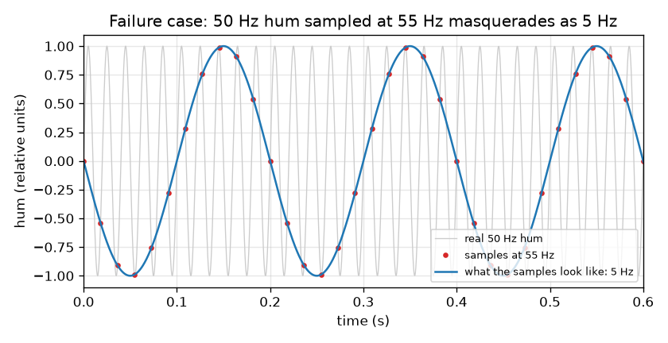
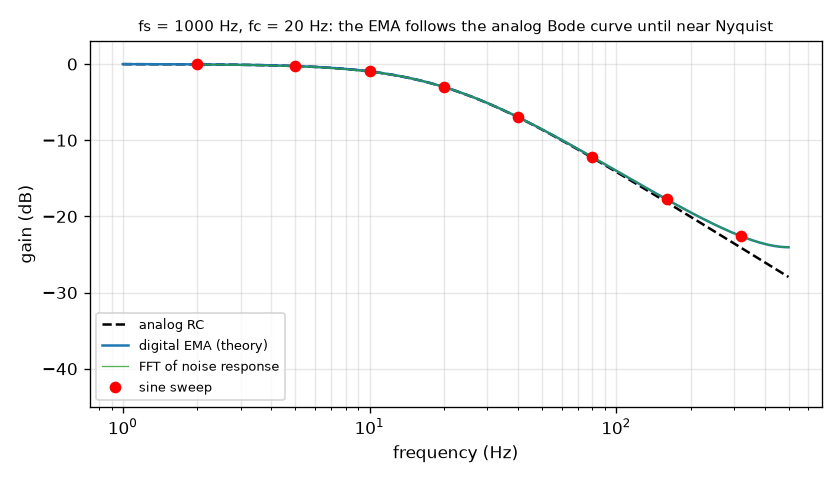
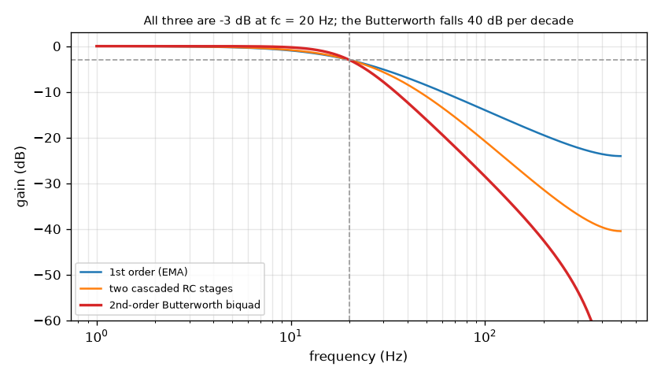
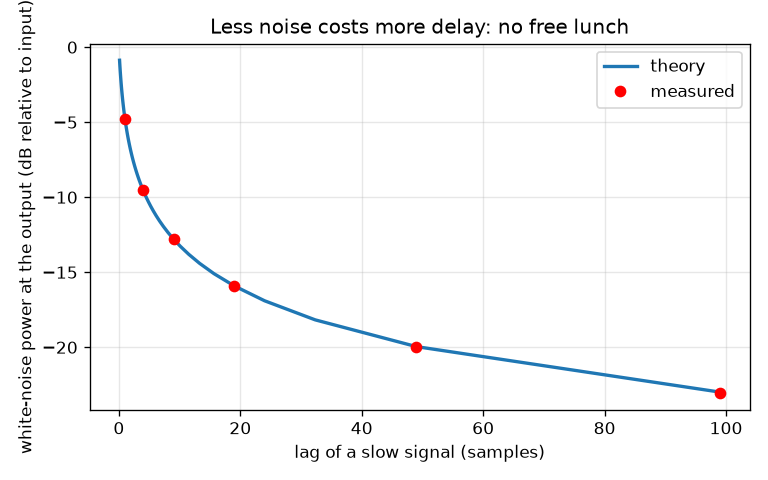
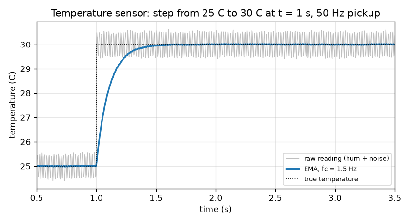

# Session 3: Digital filters: the exponential moving average, Butterworth and the limits

*Level 3 (simulation and validation) · about 90 minutes · openrcfilter*

> This is a simplified educational model. It is not a validated design tool and must not be used for real structures, electrical installations, vehicles, industrial processes or medical decisions.

**Prerequisites**

- Session 1: the RC low-pass smooths and delays.
- Session 2: gain, phase, decibels and the Bode plot.

**Learning objectives.** After this session you can:

- Implement the digital first-order filter y[n] = y[n-1] + alpha (x[n] - y[n-1]) and choose alpha from tau and the sample time.
- Measure its frequency response with sine sweeps and with an FFT, and compare it with the analog Bode curve.
- Verify the noise-reduction formula alpha / (2 - alpha) numerically and quantify the lag it costs.
- Build a second-order Butterworth biquad, check its -3 dB point, and explain two failure cases: aliasing and a cutoff above Nyquist.

## A. Real-world problem
A microcontroller samples a temperature sensor 500 times per second and cleans the numbers in software with one line of code. Does that line really behave like the RC circuit of Session 2? How much random noise does it remove, and how long must we wait for a changed temperature to show? When does it fail, and what should we use when one pole is not steep enough to remove 50 Hz hum without making the reading slow? (A simplified model for learning; real instruments need calibration and professional design.)

## B. Concept and theory
Sampling at rate fs means the sample time is dt = 1 / fs. The exponential moving average (EMA) is y[n] = y[n-1] + alpha (x[n] - y[n-1]). We choose alpha by exact (step-invariant) discretisation of the RC circuit: if the input is held constant during one sample, the capacitor moves exactly the fraction alpha = 1 - exp(-dt / tau) of the way to the input, so the digital step response equals 1 - exp(-t / tau) at every sample. (The common alternative, backward Euler, gives alpha = dt / (tau + dt); it is almost identical when fc is much smaller than fs.) The z-transform gives H(z) = alpha / (1 - (1 - alpha) z^-1), so the gain at frequency f is alpha / |1 - (1 - alpha) exp(-j 2 pi f / fs)|. It agrees with the analog gain at low frequencies but deviates near Nyquist, because the digital curve is periodic in frequency. For white noise of variance sigma^2 the output variance is sigma^2 alpha / (2 - alpha), since the impulse response h[k] = alpha (1 - alpha)^k has sum of squares alpha / (2 - alpha). A slow signal is delayed by (1 - alpha) / alpha samples, so noise power times lag equals (1 - alpha) / (2 - alpha), about 1/2: halving the noise power doubles the lag. A second-order Butterworth low-pass falls 40 dB per decade with a flat passband (Q = 1/sqrt(2)); we implement it with the standard bilinear-transform biquad (the audio-EQ cookbook low-pass) whose cutoff is pre-warped so that the -3 dB point lands exactly on fc. Sampling cannot see frequencies above fs / 2 (Nyquist): a sine of frequency f appears at |f - fs * round(f / fs)|. This is aliasing, and it cannot be undone in software. Also, the EMA has a -3 dB point below Nyquist only if alpha < 0.828, which for the exact alpha means fc < 0.28 fs.

| Symbol | Meaning | Unit |
|---|---|---|
| fs | sample rate | hertz (samples per second) |
| dt | sample time 1 / fs | seconds |
| alpha | EMA coefficient, 0 < alpha <= 1 | no unit |
| x[n], y[n] | input and output at sample n | same unit as the sensor (for example C) |
| sigma^2 | variance of the white noise | unit squared |
| Q | quality factor of the biquad (1/sqrt(2) for Butterworth) | no unit |
| fs / 2 | Nyquist frequency | hertz |

**Assumptions**

- Linear filters acting on uniformly sampled data; the input is held constant between samples for the exact discretisation.
- Noise is white (every sample independent) with constant variance.
- Frequency responses are measured in the steady state, after start-up wobble has died away.

$$ y[n]=y[n-1]+\alpha\,(x[n]-y[n-1]),\qquad \alpha=1-e^{-dt/\tau}=1-e^{-2\pi f_c/f_s} $$

$$ H(z)=\frac{\alpha}{1-(1-\alpha)z^{-1}},\qquad |H(f)|=\frac{\alpha}{\left|1-(1-\alpha)e^{-j2\pi f/f_s}\right|} $$

$$ \frac{\sigma_{\mathrm{out}}^2}{\sigma^2}=\sum_k h[k]^2=\frac{\alpha}{2-\alpha},\qquad \text{lag}=\frac{1-\alpha}{\alpha}\ \text{samples} $$

$$ \omega_0=\frac{2\pi f_c}{f_s},\ \ a=\frac{\sin\omega_0}{2Q},\ \ b_0=b_2=\frac{1-\cos\omega_0}{2(1+a)},\ \ b_1=\frac{1-\cos\omega_0}{1+a},\ \ a_1=\frac{-2\cos\omega_0}{1+a},\ \ a_2=\frac{1-a}{1+a} $$

$$ f_{\mathrm{alias}}=\left|f-f_s\,\mathrm{round}(f/f_s)\right| $$

## C. Visual explanation
Figure 1 overlays four things for fs = 1000 Hz and fc = 20 Hz: the analog Bode curve (dashed), the digital theory, the FFT of the filter's reaction to white noise, and red dots measured with sine sweeps. The three digital curves lie on top of each other and follow the analog curve until about 100 Hz; near Nyquist the digital curve flattens (at 320 Hz it is 0.0743 against 0.0624 for the analog). Figure 2 plots noise power left against lag: a smooth curve on which the measured red dots lie. Figure 3 compares one-pole, two cascaded RC stages and the Butterworth biquad, all -3 dB at 20 Hz but with different slopes. Figure 4 shows 50 Hz hum sampled at 55 Hz masquerading as a 5 Hz wave. Figure 5 shows the temperature step with the raw and filtered reading.

*Failure case: 50 Hz hum sampled at 55 Hz looks like a 5 Hz wave.*

*Gain of the EMA (fs = 1000 Hz, fc = 20 Hz): analog theory, digital theory, FFT of a noise response and sine-sweep measurements.*

*First-order EMA, two cascaded RC stages and a second-order Butterworth biquad, all -3 dB at 20 Hz.*

*White-noise power left against lag: theory and measurement.*

*Temperature step from 25 C to 30 C with 50 Hz pickup: raw reading and EMA output.*

## D. Interactive simulation
Run the lesson (`python start.py 3`), then open the live app: [Session 3: digital filter, noise and aliasing](https://krunalpanchal1995.github.io/openrcfilter/session-03/) (or `app.html` in this folder). Change fc and fs in the Bode view and see where the digital curve leaves the analog one; in the trade-off view move the dot along the curve; in the alias view lower fs until the 50 Hz hum turns into a slow wave.

**Challenge.** Leave at most 2 percent of the white-noise power, delay a slow signal by at most 40 ms, and keep the sample rate at least 200 Hz.

## E. Worked example and experiment
**Problem.** The temperature sensor is sampled at 500 Hz with an EMA of cutoff 2 Hz. Find alpha, the noise left (from 0.05 C rms), the lag, and the hum left (from 0.5 C of 50 Hz). Does it meet the limit of 0.02 C of hum? If not, try 1.5 Hz.

1. alpha = 1 - exp(-2 pi * 2 / 500) = 1 - exp(-0.02513) = 0.02482.
2. Noise power factor = alpha / (2 - alpha) = 0.02482 / 1.97518 = 0.01257, so the rms noise is 0.05 * sqrt(0.01257) = 0.0056 C.
3. Lag = (1 - alpha) / alpha = 39.3 samples = 39.3 / 500 = 78.6 ms.
4. Hum: the digital gain at 50 Hz is 0.0406, so 0.5 C of hum becomes 0.0203 C. That is above the 0.02 C limit by a hair, so 2 Hz fails.
5. Try 1.5 Hz: alpha = 0.0187, hum left 0.0152 C (passes), rms noise 0.0049 C, and the simulation gives 0.244 s to reach 90 percent of the step (passes).

**Answer.** A 2 Hz EMA at 500 Hz has alpha = 0.0248, leaves 0.0056 C of noise, lags 78.6 ms but leaves 0.0203 C of hum (just too much); 1.5 Hz leaves 0.0152 C of hum and reaches 90 percent of the step in 0.244 s.

**Experiment.** Record a real sensor (a phone's microphone or an Arduino analogue input) at 500 Hz while it is close to mains cabling, run the EMA offline, and measure the 50 Hz amplitude before and after with an FFT. Expect the measured ripple to match the digital gain formula to a few percent, but not exactly: real hum is not a perfect sine (it has harmonics at 100 and 150 Hz), real noise is not perfectly white, and the sensor itself has its own response time, all of which the model leaves out.

## Real-world application and mini-project: Design the filter for a temperature sensor with 50 Hz pickup
A sensor reads 25.0 C and the temperature steps to 30.0 C at t = 1 s. The long wire picks up 0.5 C of 50 Hz mains hum and the electronics add white noise of 0.05 C (standard deviation); the microcontroller samples at 500 Hz. The reading must have at most 0.02 C of hum left, at most 0.008 C of random noise left, and must reach 90 percent of the step (29.5 C) within 0.5 s. Using `ema_filter`, `butter_filter`, `ripple_after`, `time_to_90` and `noise_rms_after` from Session 3, scan cutoffs from 0.25 Hz to 14 Hz in steps of 0.25 Hz for both filter types.

**Deliverable:** A script that prints, for each filter type, the cutoffs that pass all three requirements, the fastest passing time to 90 percent, and which type you would ship and why; and saves a picture of the raw and filtered reading around the step for your chosen filter.

**Success looks like:** The first-order filter passes only for cutoffs from 0.75 to 1.75 Hz (fastest 0.208 s), the Butterworth filter passes from 1.00 to 5.75 Hz (fastest 0.074 s), and your write-up explains that the second-order filter gives the same hum rejection with a much faster response.

## F. Assessment and design challenge
**Question type A: Conceptual.** The exact discretisation makes the digital step response equal the analog one at every sample. Why does the digital Bode curve still differ from the analog curve near Nyquist?

Hint

What does a sampled system know about frequencies above fs / 2, and what is the digital gain at f and at fs - f?

Step-by-step solution

The digital gain is periodic in frequency: it repeats every fs, and the gain at f equals the gain at fs - f. The analog gain keeps falling as f grows, but a sampled system cannot fall forever: the curve must flatten and turn up again towards fs. Matching the step response at sample times is a time-domain statement; it does not force the frequency responses to agree everywhere. They agree well for f much smaller than fs (within 0.2 percent at fc / 2 in Figure 1) and differ near Nyquist.

**Question type B: Numerical.** An EMA with fc = 5 Hz is run at fs = 200 Hz. Find alpha, the noise power factor (also in dB), the lag in samples and in milliseconds, and the number of samples to reach 90 percent of a step.

Hint

alpha = 1 - exp(-2 pi fc / fs); factor = alpha / (2 - alpha); lag = (1 - alpha) / alpha.

Step-by-step solution

alpha = 1 - exp(-2 pi * 5 / 200) = 1 - exp(-0.15708) = 0.1454. Noise power factor = 0.1454 / 1.8546 = 0.0784, which is 10 log10(0.0784) = -11.06 dB. Lag = 0.8546 / 0.1454 = 5.88 samples = 5.88 / 200 = 29.4 ms. Samples to 90 percent: the smallest n with 1 - (1 - alpha)^n >= 0.9 is n = 15 (the simulation confirms). Sanity check: the lag of about 29 ms is close to tau = 1 / (2 pi 5) = 31.8 ms.

**Question type C: Graph and simulation interpretation.** From the noise-versus-lag graph, how many samples of lag are needed to cut the white-noise power by 10 dB? What does the trade-off say about halving the noise power again?

Hint

10 dB means a factor 0.1: solve alpha / (2 - alpha) = 0.1, then lag = (1 - alpha) / alpha.

Step-by-step solution

alpha / (2 - alpha) = 0.1 gives alpha = 0.2 / 1.1 = 0.1818, so lag = 0.8182 / 0.1818 = 4.5 samples. Because noise power times lag is (1 - alpha) / (2 - alpha), close to 1/2 for small alpha, halving the noise power again (another 3 dB) roughly doubles the lag. There is no free lunch: every dB of noise removed is paid for in delay.

**Question type D: Design and optimisation challenge.** Design: your microcontroller can only sample at 60 Hz, the signal band is below 1 Hz and 50 Hz hum is present. Why can a digital EMA with fc = 2 Hz not fix the hum, and what do you add? Give the hum removed and the loss of the 1 Hz signal for your solution.

Hint

Where does 50 Hz land after sampling at 60 Hz? Then think about what must happen before the sampler.

Step-by-step solution

At fs = 60 Hz, Nyquist is 30 Hz and the 50 Hz hum aliases to |50 - 60| = 10 Hz, where it is a perfectly legal frequency that no software can tell from a real 10 Hz signal. The EMA (fc = 2 Hz, alpha = 0.189) passes the 10 Hz alias with gain 0.205 (-13.8 dB), whereas an analog filter would have cut 50 Hz by 28 dB. The fix is an analog RC anti-alias filter before the sampler, with fc = 5 Hz: it removes 20.04 dB of the 50 Hz hum and costs the 1 Hz signal only 0.17 dB. Then the digital EMA removes the remaining alias by another 13.75 dB: total hum removed 33.8 dB; the 1 Hz signal loses 0.17 + 0.97 = 1.1 dB. Better still, raise the sample rate to 500 Hz so that no aliasing happens.

Score yourself with [RUBRIC.md](../../RUBRIC.md). Print the [activity sheet](activity_sheet.md) to work on paper.

## Common misconceptions
| Common misconception | What is actually true |
|---|---|
| A digital filter can remove any frequency, however fast. | Sampling folds frequencies above fs / 2 back into the band (aliasing). Once folded, hum looks like a real slow signal; it must be removed before the sampler. |
| The digital filter is the analog filter. | They share the same step response with the exact alpha, but the frequency responses differ near Nyquist, and the digital response repeats every fs. |
| A smaller alpha is always better. | A smaller alpha removes more noise but adds more lag: noise power times lag stays near 1/2. |
| A second-order filter is just two first-order filters with the same cutoff. | Two identical stages give -6 dB at their own cutoff; to be -3 dB at fc each stage needs a cutoff 1.55 times higher, and the knee is softer than a Butterworth. |

## Glossary
- **EMA**: exponential moving average, the digital first-order low-pass y += alpha (x - y)
- **alpha**: the fraction of the gap to the input that the EMA closes at each sample
- **discretisation**: turning a continuous-time filter into sample-by-sample update rules
- **FFT**: fast Fourier transform: splits a sampled signal into its frequencies
- **Nyquist frequency**: half the sample rate, the highest frequency a sampled signal can hold
- **aliasing**: a frequency above Nyquist showing up as a lower, false frequency
- **biquad**: a filter with two feedforward and two feedback terms, y[n] = b0 x[n] + b1 x[n-1] + b2 x[n-2] - a1 y[n-1] - a2 y[n-2]
- **Butterworth filter**: a filter with the flattest possible passband for its order

## Finish
1. Do the three coding tasks in [exercises.md](exercises.md).
2. Run `python start.py 3` again after your changes. It ends with the checkpoint; when it prints `PASS`, you are done. (Checkpoint only: `python start.py check 3`.)

Next: the [roadmap](../../promo/roadmap.md). Session 4 is yours to build.
